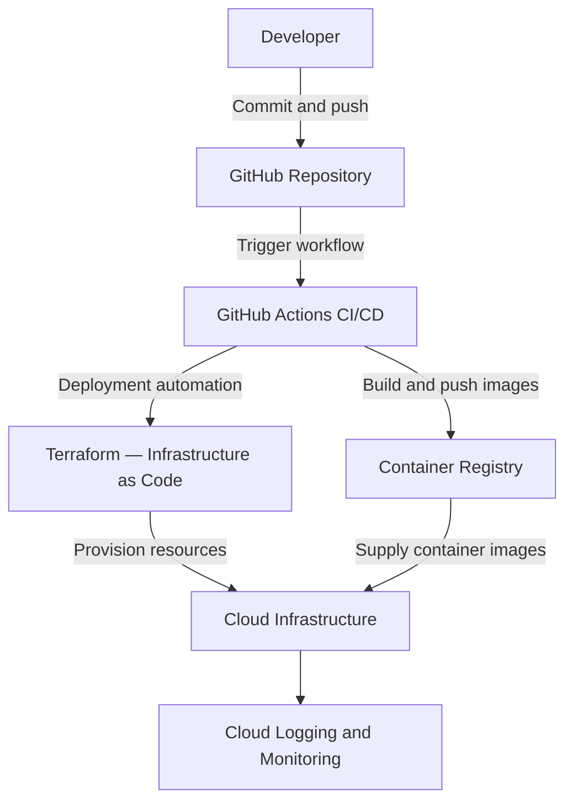

# DevOps Assignment — Architecture Diagram

## 1. Local Application Architecture

```mermaid
flowchart TD
    U[User / Browser]
    F[Frontend — HTML / Nginx<br/>Port 8080]
    B[FastAPI Backend<br/>Port 8000]
    R[Redis<br/>Message Broker and Result Backend]
    W[Celery Worker<br/>Background Tasks]

    U --> F
    F -->|POST /notify/| B
    F -->|GET /task_status/{task_id}| B
    B -->|Submit task| R
    R -->|Deliver task| W
    W -->|Store task result| R
    B -->|Read task status and result| R
```

## 2. Local Deployment

Docker Compose runs four services:

- **Frontend:** serves the HTML application.
- **Backend:** exposes the FastAPI endpoints.
- **Redis:** handles task messaging and results.
- **Celery Worker:** processes background tasks.

Start the application from the project root:

```bash
docker compose up --build -d
```

Check service status:

```bash
docker compose ps
```

Stop the application:

```bash
docker compose down
```

## 3. Intended Cloud and CI/CD Architecture



**Deployment status:** The local Docker Compose setup and local Terraform validation have been performed. The cloud infrastructure, image registry, cloud deployment, and cloud monitoring shown above are the intended design and are not yet verified as deployed.